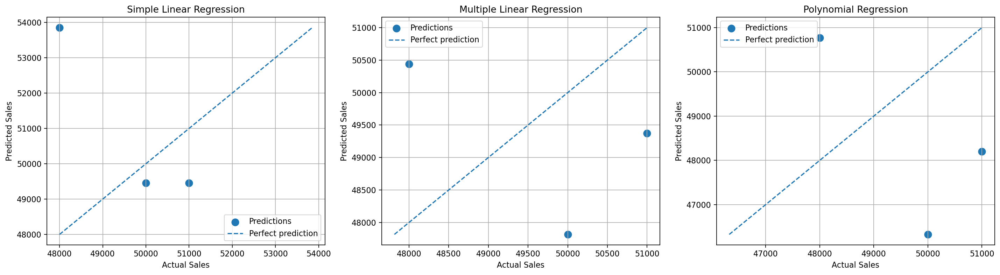
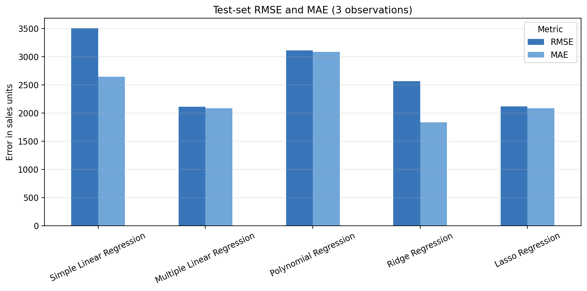

# Sales Prediction Using Regression

## Overview

This project uses a small, assignment-based retail dataset to explore whether store sales can be estimated from advertising, store size, customer count, and promotion status. The dataset is defined as a Python dictionary inside the notebook, so there is no external data file or source to download.

The notebook demonstrates data inspection, missing-value handling, feature encoding and standardization, five regression models, a sample new-store prediction, and test-set evaluation. It is a learning exercise rather than a validated forecasting system.

## Objectives and problem statement

The objective is to fit regression models that estimate the numeric `Sales` target from four store-level predictors and compare their predictions. The problem is to estimate sales for a store from the supplied attributes. The dataset has only ten observations, which is insufficient for reliable generalization claims.

## Dataset

The embedded dataset has ten observations and these five variables:

| Variable | Description |
| --- | --- |
| `Advertising_Spend` | Advertising spending value supplied for the store. |
| `Store_Size` | Store size value supplied in the dataset. |
| `Customers` | Customer count supplied for the store. |
| `Promotion` | Whether a promotion was active (`Yes` or `No`). |
| `Sales` | Numeric outcome to be predicted. |

The assignment does not specify units or an external source for these values. There is one missing value in each of `Advertising_Spend`, `Store_Size`, and `Customers`; `Promotion` and `Sales` have no missing values.

## Data preprocessing

- Missing values in the three numerical predictors are filled with their respective medians.
- `Promotion` is encoded as `Yes = 1` and `No = 0`.
- `Advertising_Spend`, `Store_Size`, and `Customers` are standardized with `StandardScaler`. `Promotion` remains 0/1.
- The notebook preserves the assignment workflow by performing imputation and standardization before the train-test split. This means the held-out predictors influence the imputation and scaling parameters. The reported metrics are therefore not from a fully leakage-free evaluation. A stronger workflow would split first, fit preprocessing on training data only (for example, in a scikit-learn `Pipeline`), and then transform the test data.

## Models

1. **Simple Linear Regression** uses `Advertising_Spend` alone.
2. **Multiple Linear Regression** uses all four predictors.
3. **Polynomial Regression** uses degree-two transformations of the three numerical predictors and includes `Promotion` as a linear predictor.
4. **Ridge Regression** uses all four predictors with `alpha=1.0`.
5. **Lasso Regression** uses all four predictors with `alpha=1.0`.

The data is split with `test_size=0.30` and `random_state=42`. This produces seven training observations and three test observations.

## Evaluation results

The table reports metrics calculated by executing the notebook. MAE and RMSE are in the dataset's sales units. R² compares predictions with a baseline that predicts the mean of the test targets.

| Model | RMSE | MAE | R² |
| --- | ---: | ---: | ---: |
| Simple Linear Regression | 3,508.32 | 2,645.50 | -6.91 |
| Multiple Linear Regression | 2,111.12 | 2,083.47 | -1.87 |
| Polynomial Regression | 3,109.98 | 3,081.63 | -5.22 |
| Ridge Regression | 2,562.04 | 1,834.80 | -3.22 |
| Lasso Regression | 2,114.93 | 2,086.41 | -1.88 |

Multiple Linear Regression has the lowest RMSE and the least-negative R² on this split; Ridge has the lowest MAE. All five R² values are negative, meaning each model performs worse on these three test observations than the test-set mean baseline. With only ten rows and three test rows, the metrics and model ranking are unstable and are not evidence of strong predictive performance.

### Plots

The first figure compares actual and predicted test sales for the simple, multiple, and polynomial models. The second compares RMSE and MAE across all five models.





## New-store prediction

The notebook applies the three original models to an example store with Advertising Spend = 4,200, Store Size = 2,100, Customers = 290, and Promotion = Yes. The executed predictions are:

| Model | Predicted sales |
| --- | ---: |
| Simple Linear Regression | 60,005.08 |
| Multiple Linear Regression | 56,905.21 |
| Polynomial Regression | 60,378.53 |

These are model outputs for an example input, not observed sales. The Ridge and Lasso models are evaluated on the test set but are not used for this new-store example.

## Key findings and limitations

- Multiple Linear Regression has the lowest test RMSE among the five models on this one split.
- Ridge has the lowest test MAE on this split.
- Polynomial Regression has zero training RMSE to two decimal places but a substantially higher test RMSE, which is consistent with overfitting in this small sample.
- Ten observations and three test observations make the metrics highly sensitive to individual rows.
- Imputation and scaling occur before the split, so held-out predictor information contributes to preprocessing.
- The dataset is embedded for the assignment and has no documented external source or units. Predictions should not be used for business decisions.

## Installation

Use Python 3.10 or later. From the project root, create and activate a virtual environment, then install the listed libraries:

```bash
python -m venv .venv
source .venv/bin/activate  # Windows: .venv\Scripts\activate
python -m pip install -r requirements.txt
```

## Run the notebook

From the project root, open the notebook with Jupyter:

```bash
jupyter notebook notebooks/Sales-Prediction-Using-Regression.ipynb
```

In Jupyter, choose **Kernel → Restart Kernel and Run All Cells** to reproduce the analysis and saved outputs. The notebook writes the figures into `results/` when run from either the project root or the `notebooks/` directory.

## Project structure

```text
Sales-Prediction-Using-Regression/
├── README.md
├── requirements.txt
├── .gitignore
├── notebooks/
│   └── Sales-Prediction-Using-Regression.ipynb
└── results/
    ├── actual_vs_predicted.png
    └── model_comparison.png
```

## Technologies

- Python 3.10+
- pandas 2.2.3
- NumPy 2.1.3
- Matplotlib 3.10.0
- scikit-learn 1.6.1
- Jupyter 1.1.1
